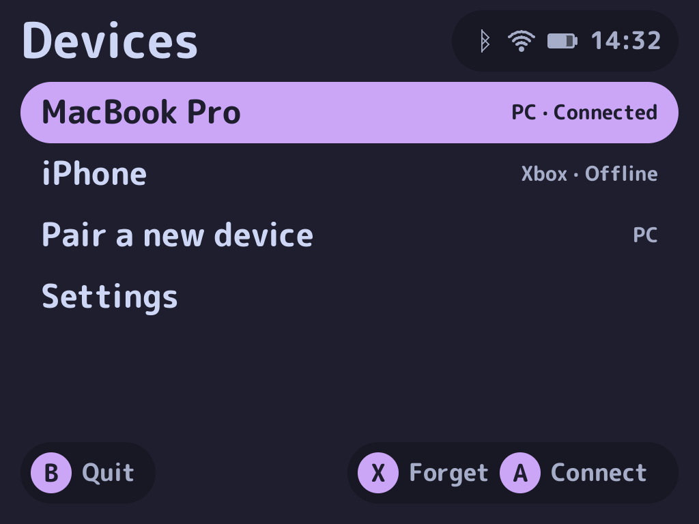
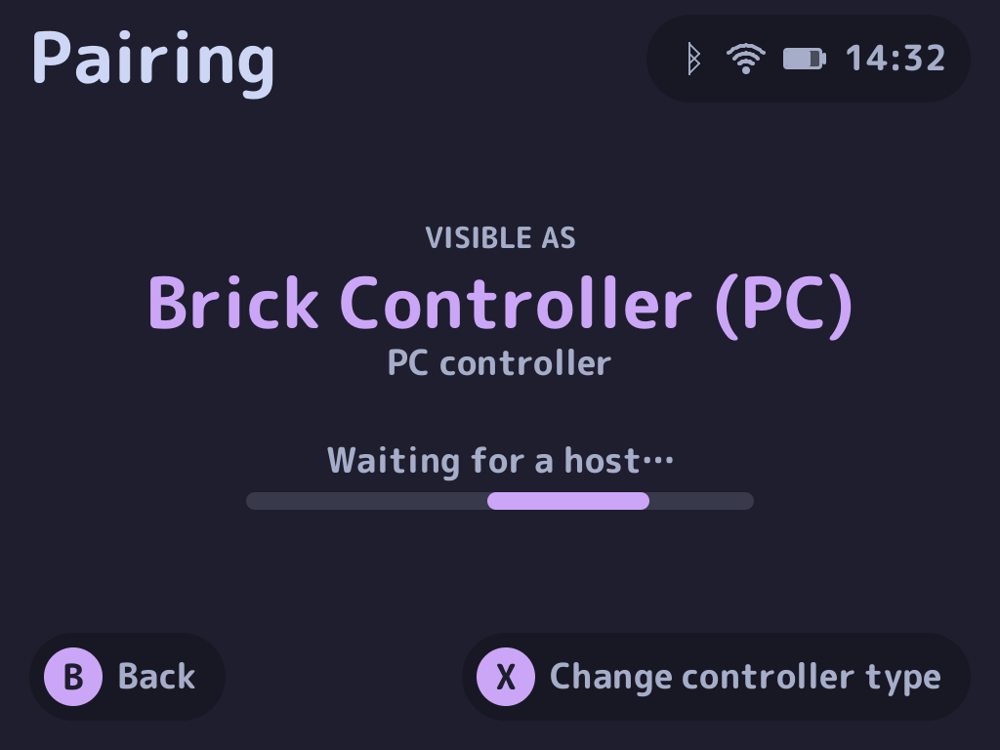
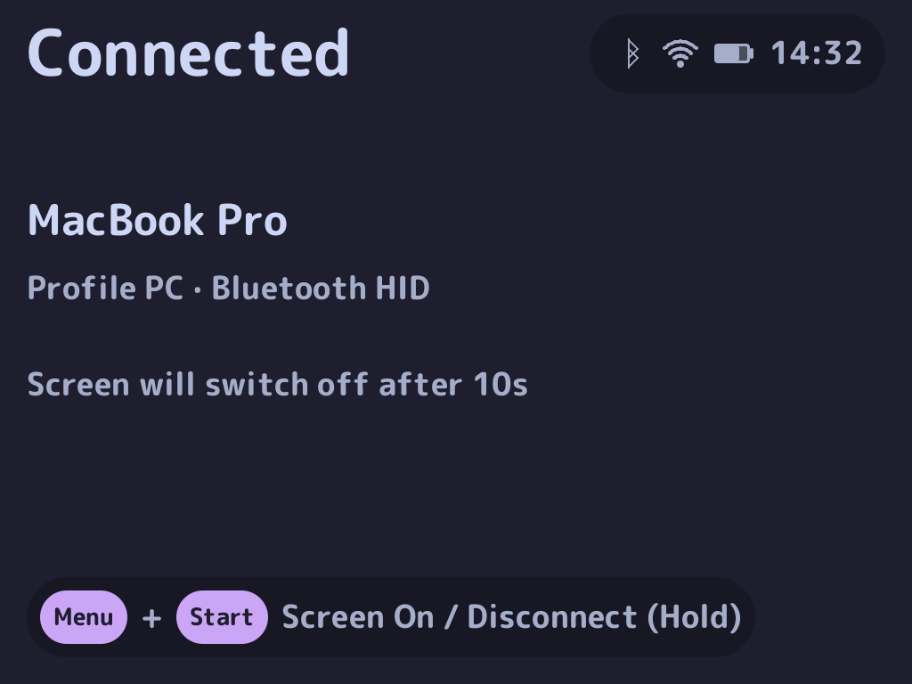
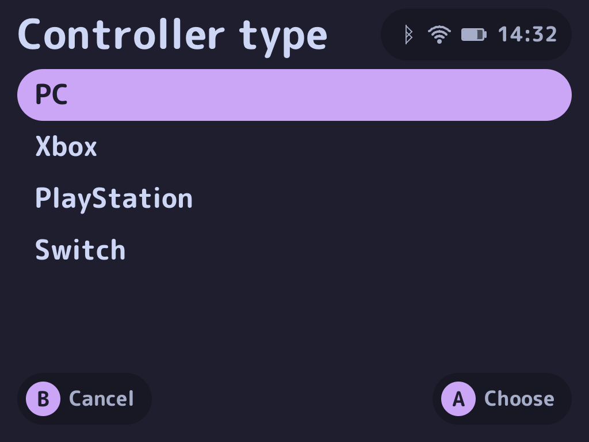
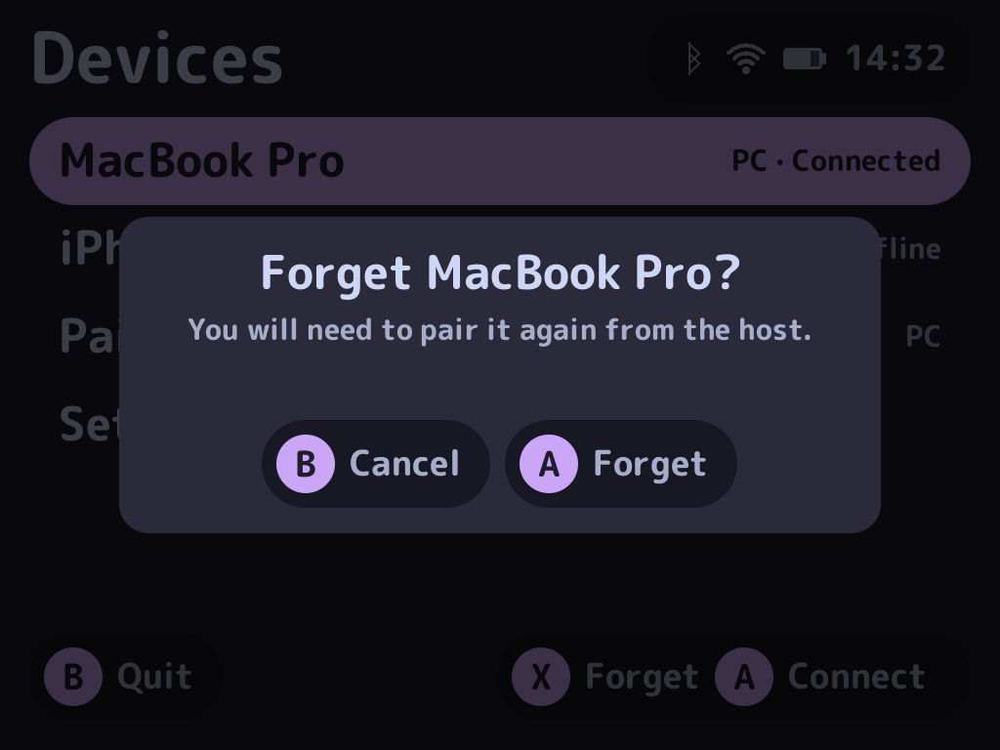
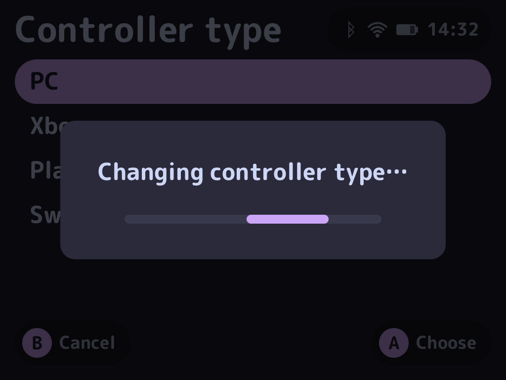
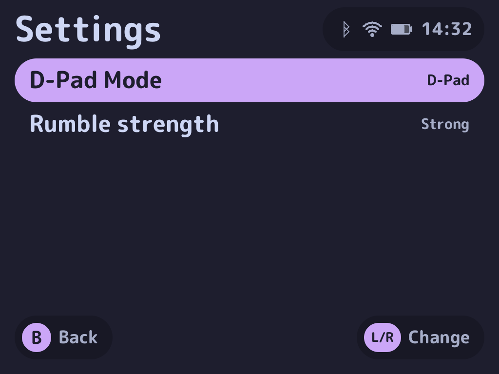

# Brick Controller

**Turn a TrimUI Brick or Brick Pro into a Bluetooth gamepad. No driver on the
host.**

<p align="center">
  
</p>

Brick Controller is a NextUI Pak. It makes the handheld appear as a standard
Bluetooth HID controller to a PC, Mac, Linux/SteamOS machine, Android device or
iPad. Pair it the way you would pair any other gamepad, then play.

> **Status.** The Brick is supported. The Brick Pro uses the same `tg5040`
> package and code path, but has not yet been validated on Brick Pro hardware.
> Smart Pro and `tg5050` are not supported yet: the app refuses to start on
> them. Bluetooth only; USB HID is not available yet.

> **Found a problem?** Brick Controller is a community Pak; NextUI maintainers
> do not provide support for it. Open a bug report from the repository's
> **Issues** tab and attach the log. [Troubleshooting](#troubleshooting)
> explains where to find it.

## What you get

- A real Bluetooth gamepad: D-pad, A/B/X/Y, L1/L2/R1/R2, Start, Select and
  Menu. On the Brick standard, F1/F2 work as L3/R3. On the Brick Pro, the two
  Hall-effect sticks and the real L3/R3 clicks follow the same input path; its
  Fn keys are not mapped.
- Four controller identities to choose from when pairing: PC, Xbox,
  PlayStation and Switch.
- A **Devices** home screen that lists your paired hosts. Nothing connects
  until you choose it.
- A **Settings** screen under Devices: send the D-pad as a D-pad or as the left
  stick, and choose the rumble strength between Off, Low, Mid and Strong.
- A screen that gets out of the way: the panel turns off after 10 seconds while
  the gamepad keeps working. Tap **Menu+Start** once to wake it.
- A status bar with the time, Bluetooth, Wi-Fi and battery state.
- Rumble in Xbox, PlayStation and Switch modes.
- A clean exit: NextUI gets its Bluetooth, brightness and volume settings back.

## Screens

| Devices | Pairing | Connected |
| --- | --- | --- |
|  |  |  |
| Your paired hosts, **Pair a new device** and **Settings**. | The name, controller type and a waiting indicator. | The host, the active profile and the sleep hint. |

| Controller type | Forget a host | Changing type |
| --- | --- | --- |
|  |  |  |
| Pick the identity for the next pairing. | Forgetting always asks for confirmation. | The Bluetooth session restarts with the new identity. |

<p align="center">
  
</p>

The **Settings** screen opens from Devices. The D-pad selects a line,
left/right changes its value, and **B** returns to Devices.

## Getting started

### What you need

- A TrimUI Brick or Brick Pro running NextUI (`tg5040`).
- Bluetooth enabled in NextUI.
- The `Brick Controller.pak` folder, or the release zip.

A USB-C cable is only needed for development over ADB or SSH. Normal use is
wireless.

### Install

The `v1.0.0` release is being submitted to Pak Store. Until it appears, use the
manual installation.

#### Manual installation

1. Download the release zip.
2. Create this folder on the SD card:

   ```text
   /mnt/SDCARD/Tools/tg5040/Brick Controller.pak/
   ```

3. Extract the contents of the zip into that folder. `launch.sh` and
   `brick-controller` must sit directly inside `Brick Controller.pak/`.
4. Put the SD card back in the handheld.
5. Open **Tools → Brick Controller**.

The Brick Pro uses the same `tg5040` folder and the same package as the Brick
standard.

### Pair your first host

1. Turn Bluetooth on in NextUI.
2. Open **Brick Controller → Pair a new device**.
3. Press **X** to choose the controller type.
4. On the host, open its Bluetooth settings and pair with the name shown on the
   handheld:
   - `Brick Controller (PC)`
   - `Brick Controller (Xbox)`
   - `Brick Controller (PS4)`
   - `Brick Controller (Switch)`
5. The **Pairing** screen completes when the host connects.

The type is chosen for the next pairing. An already paired host keeps the
identity it first saw; to change it, forget the host on both sides and pair
again.

## Everyday use

- **Devices** is the home screen. It does not connect to a host on its own.
- **A** connects the selected host, opens **Pair a new device** or opens
  **Settings**.
- In **Settings**, the D-pad up/down selects a line and left/right changes its
  value. **B** returns to Devices.
- **X** forgets the selected host after confirmation.
- **B** quits the app from the Devices screen.
- Hold **Menu+Start** for 1 second to disconnect and return to Devices.
- Tap **Menu** on the controller view to send Home/Guide.
- After 10 seconds, the panel turns off. Tap **Menu+Start** once to wake it;
  this does not send the chord to the host.

Start and Select reach the host as normal gamepad buttons. While an interface
screen is open, gamepad input is kept away from the host.

## Controller types

Choose the type that matches the host drivers. The host sees the Bluetooth
name, not the internal profile name.

| Type | Bluetooth name | Best for |
| --- | --- | --- |
| **PC** | `Brick Controller (PC)` | Windows, Linux/SteamOS, Android, and Mac/iPad apps that read HID directly (Steam, for example) |
| **Xbox** | `Brick Controller (Xbox)` | XInput on Windows; native Xbox support on macOS, iPadOS and Android |
| **PlayStation** | `Brick Controller (PS4)` | Hosts with DualShock 4 support: Windows, macOS, Linux, Android and iPadOS |
| **Switch** | `Brick Controller (Switch)` | Native Pro Controller support on macOS, iPadOS and Windows |

On Apple hosts, use **Xbox**, **PlayStation** or **Switch**. macOS does not
expose a generic HID gamepad to its GameController framework, so the PC profile
does not appear in System Settings or in games built on that framework.

## Good to know

- **Bluetooth only.** USB HID is not part of this release.
- The Smart Pro and Smart Pro S are not supported yet. On those models the app
  shows an unsupported-device screen and exits without taking over Bluetooth.
- Rumble works in Xbox, PlayStation and Switch modes. The PC profile has no
  output report, so PC hosts do not vibrate the handheld.
- **D-Pad Mode** in Settings sends the D-pad as the left stick instead of the
  hat. The app's own screens still navigate with the D-pad. On the Brick Pro the
  physical sticks keep working; a D-pad press takes over while it is held.
- **Rumble strength** scales the host's request: Off 0 %, Low 30 %, Mid 60 %,
  Strong 90 %. The two Settings values are saved on the SD card and survive a
  restart.
- The Brick standard has no analog sticks, gyro, trackpads or back buttons.
  Sticks are reported centred for host compatibility. The Brick Pro adds two
  Hall-effect sticks and real L3/R3 clicks, with its Fn keys left unmapped.
- Bluetooth audio and the controller cannot share the radio cleanly. `bluealsa`
  is stopped while the controller runs and restored on exit.
- Wi-Fi and Bluetooth share one antenna on the Brick and Brick Pro. Expect
  reduced Wi-Fi throughput during a session.
- Windows has been tested less than macOS, across all profiles.
- The PlayStation profile presents a DualShock 4. It does not emulate a
  DualSense, its lightbar, touchpad, adaptive triggers or motion sensors.
- The Switch profile does not send IMU, NFC or IR data, and its single motor
  receives the strongest rumble band rather than HD rumble. It targets the
  hosts above, not the Nintendo Switch console itself.
- A host remembers the controller identity it first paired. To switch types,
  forget the old pairing on the host and pair again.

## Troubleshooting

Logs are written to:

```text
/mnt/SDCARD/.userdata/tg5040/logs/BrickController.txt
```

The previous run is kept as `BrickController.txt.1` when the log rotates.

### Reporting a bug

Open a bug report from the repository's **Issues** tab, or use the
[bug report form](../../issues/new/choose). The form asks for the handheld
model, the NextUI version, the host, the controller type, the steps to
reproduce the problem and the log.

To retrieve the log:

1. Power off the handheld and remove the SD card.
2. Connect the card to a computer.
3. Open the hidden `.userdata` folder at the root of the card:
   - Windows: in File Explorer, open **View → Show → Hidden items**.
   - macOS: press **Cmd+Shift+.** in Finder.
4. Copy `tg5040/logs/BrickController.txt` from `.userdata`.

Attach the file to the issue. If the current log is empty or does not cover
the problem, attach `BrickController.txt.1` as well.

The log records the Bluetooth names and addresses of the hosts you paired.
Mask them if you do not want them public.

Include the Pak version, the handheld model, the NextUI version, the host OS,
the controller type, and what you expected versus what happened. A photo of
the screen helps when the interface is wrong.

### Recovery

If Bluetooth stays stopped after a crash or a forced exit, reboot the handheld
or run:

```sh
/mnt/SDCARD/.system/tg5040/etc/bluetooth/bt_init.sh start
```

If the panel stays dark, press **Menu+Start** once to wake it. To restore
NextUI's own brightness and volume settings, run:

```sh
/mnt/SDCARD/.system/tg5040/bin/syncsettings.elf
```

If pairing fails, remove the old pairing on both sides, choose the controller
type again in the Pairing screen, and pair once more.

## Build from source

Requires Rust and the `aarch64-unknown-linux-musl` target. The Pak Store
archive check also needs `jq` and `unzip`:

```sh
export PATH="$HOME/.cargo/bin:$PATH"
rustup target add aarch64-unknown-linux-musl
cargo fmt --all
cargo test --workspace
cargo build --release --target aarch64-unknown-linux-musl -p brick-controller
VERSION=v1.0.0 ./apps/brick-controller/deploy/package.sh
./scripts/check-pak.sh v1.0.0
```

The binary is static; no Rust runtime is needed on the handheld.

## Credits and license

This project is based on **Padpod**, the TrimUI Brick Pro Bluetooth controller
by ligt and its contributors: <https://github.com/duyquang6/padpod>. Padpod is
licensed under the GNU GPL v3 with additional terms. The license and credits
travel with the pak (`LICENSE`, `ADDITIONAL-TERMS.md`, `CREDITS.md`, `OFL.txt`).

This modified version is released under the same GPL-3.0 terms and additional
terms as Padpod. It is not an official Padpod release.

The Switch Pro Controller protocol implementation is ported from
[deck-as-controller](https://github.com/jmedina21/deck-as-controller) (MIT).
The MIT notice is kept in `profiles/switch_pro.rs` and in `CREDITS.md`.
